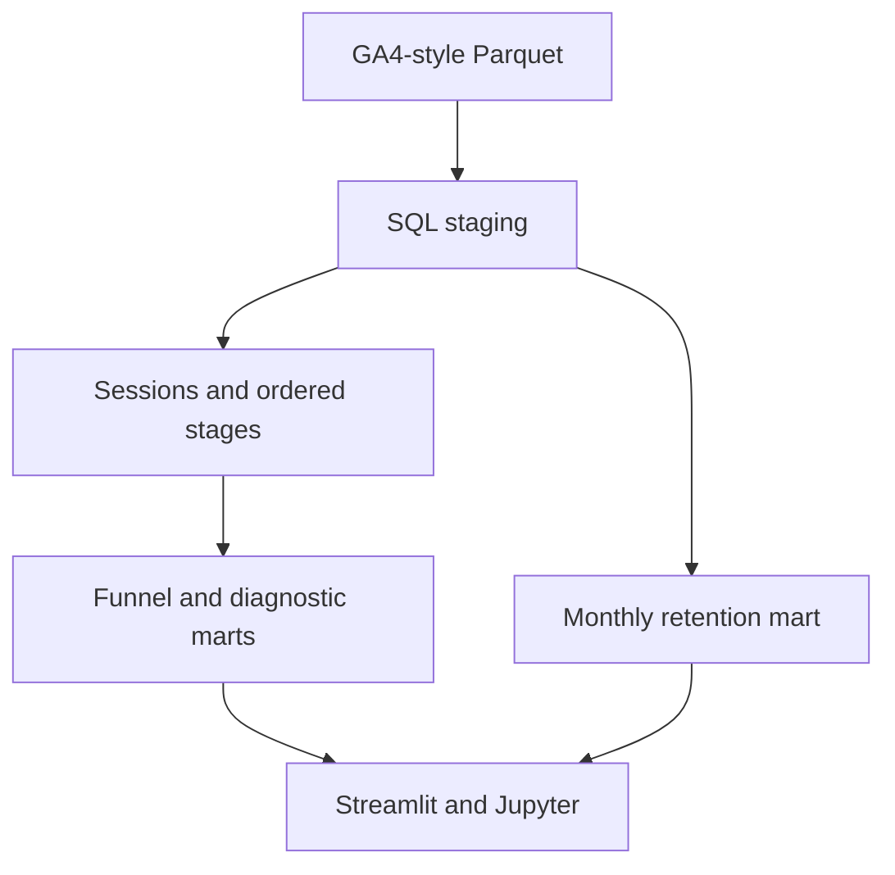

# Commerce Funnel & Retention Analytics

A Python and SQL analytics application for investigating ecommerce checkout loss, acquisition-cohort retention, and experiment opportunities. Explore a working synthetic GA4-style dataset through an interactive Streamlit dashboard or an executable notebook.

## Start locally

Use Python 3.11 and an isolated environment. Run commands from the repository root:

```bash
python -m venv .venv
source .venv/bin/activate
python -m pip install -r requirements-dev.txt
# For the tested Linux/Python 3.12 environment: pip install -r requirements.lock.txt
python -m pytest -q
streamlit run dashboard/app.py
```

On Windows, activate with `.venv\Scripts\activate`. The bundled Parquet dataset works without cloud credentials. The app listens on port 8501. Select devices in the sidebar; use **Reload dataset** after replacing the configured input.

## Analytical capabilities

- Ordered, within-session view → cart → checkout → purchase funnel, with dynamic loss summaries.
- Device and traffic-medium segmentation, purchase-event revenue and cart-value distributions.
- User and revenue retention heatmaps using calendar-month acquisition cohorts.
- Explicit zero-activity months, acquisition-month revenue baselines, and partial-month caveats.
- First-cart-session-per-user device comparison, Wilson confidence intervals, and guarded chi-square inference.
- Hour-of-day diagnostics and device-level page-load summaries.
- Interactive fixed-horizon experiment sample-size and duration planning.
- Non-destructive missing-key, duplicate-candidate, negative-value and model-invariant checks.
- SQL-side chart aggregation, deterministic bounded diagnostic samples, paginated CSV exports and streamed complete exports.
- Optional transaction-level reconciliation: deduplication, conflict detection, currency separation, refunds and IANA-timezone daily reporting.
- Configurable quality gates, freshness checks and validation-gated atomic batch publication.
- Traffic-standardized device comparisons and calendar/latency sensitivity analysis, with a reproducible analytical case study.
- Optional shared-workspace access gate, input-change refresh detection, notebook analysis, chart exports and measured workload profiles.
- Exact-size synthetic load-fixture generation, configurable up to 50 million events and beyond.

## Stack and architecture

Python, SQL, Pandas, NumPy, DuckDB, Streamlit, Plotly, SciPy, Jupyter, PyArrow, and Google Cloud BigQuery. The existing layer-based approach is preserved: nested Parquet input → SQL staging → session and funnel intermediates → analytical marts → dashboard and notebook. No web API, orchestration service, or separate frontend framework is required.



```text
 dashboard/    Streamlit interface and session controls
 data/         Synthetic nested events and sample generator
 sql/          Query engine, statistics, quality checks
   staging/    Event flattening
   intermediate/  Sessionization and ordered funnel stages
   marts/      Funnel summary, cohort retention, diagnostics
 notebooks/    Executable analytical investigation
 scripts/      Benchmarks, chart export, load fixtures, cloud export
 tests/        Sample regression and hand-constructed edge cases
 images/       Self-contained interactive analytical charts
 docs/         Measurement contract, operations and benchmark evidence
 .github/workflows/  Automated tests and compilation checks
```

`services/` adds bounded reads, transaction reporting, monitoring, ingestion, access controls and sensitivity analysis without replacing the SQL layers. `config/` contains quality thresholds.

The engine loads SQL files as the single source of model logic. Each engine instance owns an in-memory DuckDB connection; query access is serialized by a lock. Streamlit caches the engine resource using input file or manifest metadata; filter selections live in Streamlit widget state. Changing the configured input metadata triggers a new snapshot on the next rerun. The default execution materializes the models once so interactive queries do not repeatedly flatten nested parameters. Lazy-view mode remains available for comparison. Startup costs and memory requirements are disclosed in the benchmark, rather than hidden in query speed claims.

## Measurement contract

**Funnel grain is a session**, identified by `(user_pseudo_id, session_id)`. Later stages qualify only after earlier stages within the same session. Equal timestamps qualify because source timestamps may have limited resolution. Revenue includes all purchase events, including those outside the ordered funnel. Revenue per purchase event is not revenue per unique buyer. Unknown or missing session identities are visible in quality checks but excluded from session models.

**Retention grain is a user-month**. Cohort month is first observed activity, which may differ from true acquisition when the observation window is truncated. Revenue retention uses acquisition-month revenue, yields null for a zero-revenue denominator, and is not subscription NDR. Future months are absent; missing activity in observed months is zero. The latest month can be incomplete. Cohorts are all-device and are explicitly labeled separately from device-filtered session charts.

The bundled data is synthetic. Device differences in it reflect generation assumptions. They do not demonstrate customer behavior, causal friction, or a realized business impact. The separate revenue ledger uses authoritative transaction IDs for purchases and event IDs for individual refunds. Missing IDs and conflicting payloads are quarantined rather than guessed. Original event-revenue KPIs retain their existing definitions.

## Analytical investigation

[Checkout progression case study](docs/CASE_STUDY.md) investigates the observed device gap with unique-user denominators, common traffic strata, calendar sensitivity, latency caveats and an explicitly falsifiable recommendation. Its supporting CSVs and JSON are regenerated by `python scripts/analyze_case_study.py`. The included results describe synthetic behavior; actual product decisions require representative real source data.

## Transaction reconciliation demo

The default dataset remains unchanged. An additional synthetic dataset includes transaction identities, known duplicate purchases and partial refunds:

```bash
COMMERCE_DATA_PATH=data/commerce_transaction_events.parquet streamlit run dashboard/app.py
```

Open **Revenue reconciliation**, enable **Load transaction audit**, and inspect accepted versus rejected records, per-currency net revenue and timezone-adjusted dates. `data/generate_transaction_sample.py` reproduces the fixture from the default sample; choose a new output path when regenerating.

## Data and Python interface

See [data contract](docs/DATA_CONTRACT.md) for source fields and model columns. There is no HTTP API. Use the Python interface or query marts directly:

```python
from sql.data_engine import DataEngine
with DataEngine() as engine:
    result = engine.query(
        'SELECT * FROM fct_funnel_summary WHERE device_category = ?',
        ['mobile'],
    )
    print(result)
```

`DataEngine(parquet_path=None, materialize=True)` accepts a Parquet file, glob or explicit list of files. With no explicit path, `COMMERCE_MANIFEST_PATH` can select a published manifest. `query(sql, parameters=None)` returns a Pandas DataFrame. `close()` releases the connection; the context manager closes automatically. This is a trusted local analytical interface, not an untrusted SQL execution endpoint.

## Workflows

```bash
# Generate the standard synthetic sample (replaces the default sample)
python data/generate_sample_data.py
# Rebuild and open the analytical notebook
python scripts/build_notebook.py
jupyter notebook notebooks/commerce_funnel_retention.ipynb
# Export self-contained interactive charts
python scripts/export_charts.py
# Measure lazy views versus materialized SQL on configured input
python scripts/benchmark.py --output docs/benchmark.json --repeats 5
# Create an exact-size 50M-event load fixture in bounded chunks
python scripts/scale_dataset.py --events 50000000 --output data/scale
# Start against the generated files; quote the glob
COMMERCE_DATA_PATH='data/scale/*.parquet' streamlit run dashboard/app.py
```

Load fixtures replicate the sample with isolated user identities. This is appropriate for execution profiling, not for increasing statistical evidence. The final replica can truncate a user history. It does not produce 50 million independently observed events. At large scale, profile model startup, RAM, temporary spill storage, and concurrent dashboard use before deployment.

## BigQuery data import

The dashboard executes locally. The optional exporter retrieves the GA4 public ecommerce sample with a bounded table-suffix predicate, typed parameters, a billing cap, and dry-run default. Public sample dates differ from the bundled synthetic dates.

```bash
# Configure Application Default Credentials outside the repository first
python scripts/export_bigquery.py --billing-project YOUR_PROJECT --start 20201101 --end 20201107
# Add --execute to run the bounded query and create a new Parquet file
python scripts/export_bigquery.py --billing-project YOUR_PROJECT --start 20201101 --end 20201107 --execute --output data/bigquery_events.parquet
COMMERCE_DATA_PATH=data/bigquery_events.parquet streamlit run dashboard/app.py
```

Credentials and a billable project are required. Cloud import is optional. CI exercises its dry-run and streaming behavior with a mocked client; a credentialed cloud round-trip remains environment-specific. Choose a short range. The exporter streams Arrow batches into Parquet and atomically publishes the completed output. Never commit credentials or raw personal analytics exports.

## Performance evidence

[Measured benchmark JSON](docs/benchmark.json) contains event count, runtime versions, individual timing samples, startup costs, and median query durations. The script checks numerically equivalent outputs between execution modes. These are local observations on the bundled input, not production latency guarantees.

[Workload profiles](docs/PERFORMANCE.md) record model build time, peak process memory, bounded chart-query latency and shared-reader contention on both 102,028 and 1,000,000 events. No 50M-event runtime or commercial impact is claimed.

## Monitoring, ingestion and complete exports

```bash
# Quality gate; returns nonzero if any configured threshold fails
python scripts/monitor.py --thresholds config/quality_thresholds.json --output health.json
# Add --max-age-hours 24 for a live source; omit it for historical research data
# Publish a validated append-only batch and an atomic input manifest
python scripts/ingest.py data/ga4_sample_events.parquet --directory data/ingestion
COMMERCE_MANIFEST_PATH=data/ingestion/manifest.json streamlit run dashboard/app.py
# Stream all matching sessions to an output CSV without one large Pandas frame
python scripts/export_sessions.py --output exports/mobile_sessions.csv --devices mobile
```

Batch identity uses SHA-256: re-ingesting identical file bytes is a no-op. Invalid batches leave the previous manifest active. Different overlapping batches remain distinct raw events; transaction auditing handles known revenue identities separately. The publisher is local-filesystem based; it does not implement a distributed lock or incremental SQL mart updates.

## Deployment and operational boundaries

See [operations](docs/OPERATIONS.md) for hosted startup, configuration, validation and recovery. Use the same requirements file on a Python 3.11 host or Streamlit Community Cloud, with `dashboard/app.py` as entry point. For a private installation, place access control and TLS at your hosting boundary. An optional one-hour shared-workspace password session is available through `COMMERCE_ACCESS_PASSWORD`; managed deployments should use host SSO/TLS and rate limiting. There is no tenant isolation.

Transaction auditing, timezone reporting, currency separation, freshness gates and atomic incremental file ingestion are implemented as optional integrations. Validate their identity/currency assumptions against your source before rollout. Current limits include shared in-memory snapshots, all-device cohorts, full SQL model rebuilds on refresh, no currency conversion, no tenant isolation and no measured 50M/browser-load result. Incremental file publication does not imply incremental SQL mart maintenance.

## License

MIT. Required license notices are retained in `LICENSE`.
